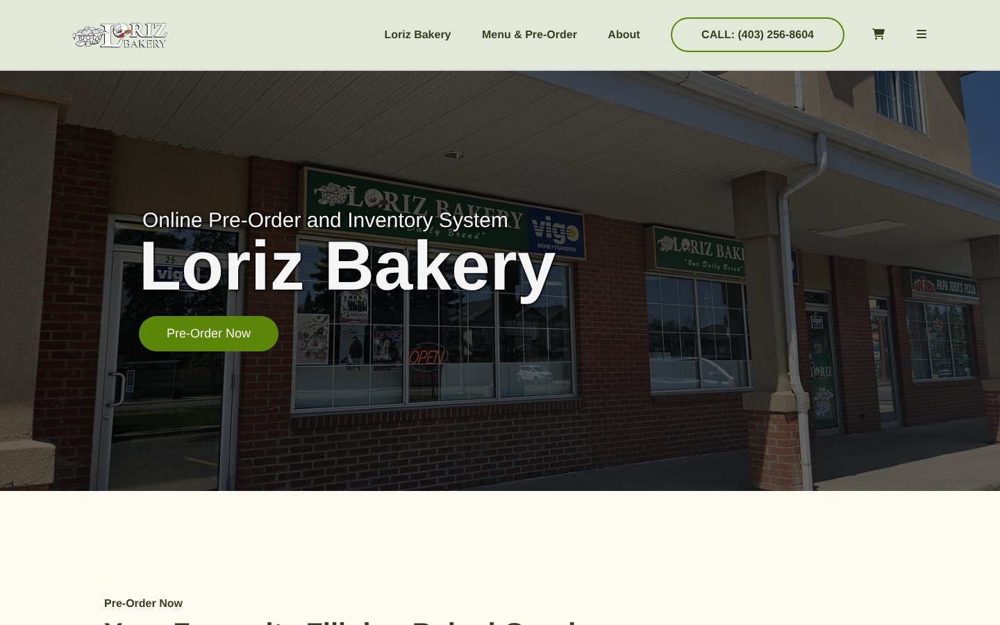

# Loriz Bakery - Online Pre-Order & Inventory System

Capstone project for Loriz Bakery, a Filipino bakery in Calgary. Customers browse the menu and place pick up pre-orders without an account. Staff log in to a dashboard to manage products.
--> Team: Jasmaan Sekhon, Eliah Rebong, Hassan Khalil, Jean Pierre Louis
Bacud, Justin Gracilla, and Ralph Julian Paul Pagulayan

Built with PHP (PDO), MySQL, and vanilla JavaScript.



## Features

Customer side:
- Menu with search and category filters
- Product pop-up with quantity and variants (e.g. sliced or unsliced bread)
- Add to cart with the Fetch API, no page reload
- Guest cart tied to the session, no sign-up needed
- Checkout with pick-up date and payment method

Staff side:
- Login with session-based access
- View, add, and delete products

## Database

Five tables: products, cart items, orders, order items, and staff users. Definitions are in `database/schema.sql`. I rebuilt that file from the app's queries, since the original database was on hosting that has since expired.

## Running locally

Needs PHP with the `pdo_mysql` extension and MySQL or MariaDB. XAMPP and MAMP include both.

1. Create a database and import the schema:
   ```
   mysql -u root -p -e "CREATE DATABASE loriz_bakery"
   mysql -u root -p loriz_bakery < database/schema.sql
   ```
2. Copy `config.example.php` to `config.php` and add your database details.
3. Run `php -S localhost:8000` and open http://localhost:8000

Serve it from the web root, since pages link with root-relative paths like `/menu.php`.

## Status

The customer ordering flow works. The staff dashboard is partly finished. See `TODO.md`.
